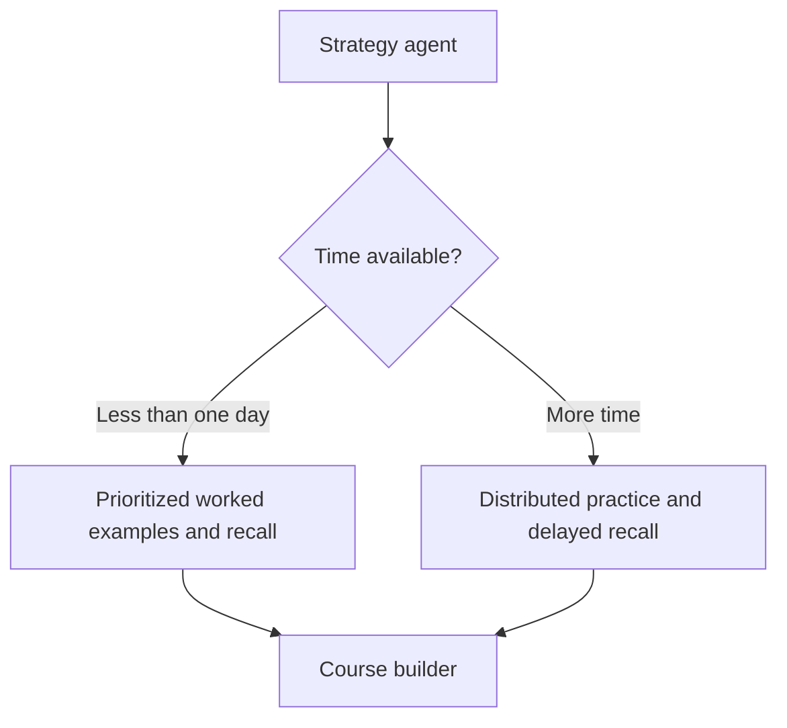

# Solve.ai agent orchestration

The Mermaid files are the editable source of truth. The target workflow describes the intended exam-helper product from `researchingoogle.txt`. The three current-workflow diagrams describe the implementation in `backend/main.py` and `app/api.ts`. The PDF requirements were not used: a working local PDF reader was unavailable during this pass.

## Diagrams

| File | What it describes |
| --- | --- |
| [agents-orchestration.mmd](agents-orchestration.mmd) | Complete target workflow: intake, question-bank routing, discovery, evidence approval, strategy, learning, adaptation and review |
| [current-source-to-course.mmd](current-source-to-course.mmd) | Implemented source intake, extraction, selection, course generation and validation |
| [current-learning-loop.mmd](current-learning-loop.mmd) | Implemented diagnostic, practice, repair, uncertain assessment and delayed recall transitions |
| [current-ai-gateway.mmd](current-ai-gateway.mmd) | Implemented request boundaries, shared model calls, quotas, retry limits, validation and persistence |

The target diagram uses blue for proposed AI roles, green for existing AI roles, grey for tools/controllers and orange for learner actions. Arrows show handoffs; dotted arrows show supporting state, optional adaptation or shared services. These diagrams do not imply that the runtime executes every role concurrently.

## Agent responsibilities and current status

An agent here means a responsibility with defined inputs and outputs. It does not require a separate service, process, model or orchestration framework.

| Role | Inputs | Output / handoff | Current status |
| --- | --- | --- | --- |
| Orchestration controller | Session, current task, sources, learner progress | Select tool or AI role; validate output; commit state; choose next task | Implemented as FastAPI route logic and `next_task`; deterministic |
| Intake agent | Goal, exam, target marks, syllabus, time, deadline and starting knowledge | Student constraints and missing-information questions | Planned; current intake is a form for goal, level, minutes and deadline |
| Resource controller | Supplied sources, syllabus and question-bank scope | Decide between supplied material and discovery | Planned automatic routing; current source selection is manual |
| Discovery agent | Subject, institution, exam, syllabus and missing evidence | Candidate resource links and matching source metadata | Planned; current `resources` route returns Brave results or search links |
| Extraction tools | Pasted text, PDF bytes or public URL | Clean readable passages with source and page identifiers | Implemented with PyMuPDF, BeautifulSoup and public-URL validation; no LLM needed |
| Evidence selector | Goal and approved passages | Evidence pack for generation | Implemented as keyword selection, capped at 20 passages; no vector database |
| Strategy agent | Approved evidence, time, marks, topic gaps and prerequisite order | Prioritized approach, technique and remaining study plan | Planned; current course prompt uses goal, starting level and minutes |
| Course builder | Goal, level, available minutes and selected evidence | `Course`: ordered concepts, explanations, steps, citations and four question types | Implemented through `generate(Course, ...)` |
| Output validator | Typed course and selected passages | Accept verified structure or reject before saving | Implemented; quotation matching is not proof that every generated explanation is correct |
| Assessment agent | Current question, private answer criteria, learner answer and cited passages | `Feedback`: correct, partially correct, incorrect or unable to assess; missing steps and suspected gap | Implemented through `generate(Feedback, ...)`; reviewed demo uses deterministic checks |
| Fresh-question agent | Concept, quoted evidence and previously answered prompts | `Question`: distinct prompt and private answer criteria | Implemented only when existing unseen questions are exhausted |
| Progress and recall controller | Assessment result, phase and saved timestamps | Update progress; choose another task or due recall | Implemented; initial recall delay is 24 hours |
| Human review | Student report, task ID and timestamp | Saved correction report | Implemented storage only; no review dashboard or automatic prompt changes |

## Execution rules

1. Keep learner decisions explicit. Source approval comes before course generation. In the target design, a definitive question bank restricts evidence scope until the student changes that scope.
2. Keep dependent work sequential: evidence approval -> strategy -> course -> validation -> task -> answer -> assessment -> next task. Independent extraction or discovery could be parallelized later; that is not how the current write pipeline operates.
3. Treat sources and answers as untrusted data. Every AI role uses only its approved evidence, and the controller checks output structure before changing persisted state.
4. Reuse tools and questions first. Current `fresh_task` tries the requested question, then unused alternates, before asking the model for another question.
5. Save after successful route work. If assessment or follow-up generation fails before `save`, the previous persisted attempt and progress remain unchanged. A browser timeout can occur after the server commits: reload the session before retrying.
6. Keep uncertainty separate from failure. `unable_to_assess` saves feedback and the attempt but leaves the current task and progress unchanged.
7. Resume the saved task. When no task remains, the current controller selects due reviews before unfinished concepts. Reviews are checked when the session is loaded; there is no background notification worker.

## Current limits and differences from the target

- One shared `generate` function handles three AI output types. There is no autonomous multi-agent runtime, planner framework or parallel lesson/quiz/diagram generator.
- Deadline is stored but is not sent to course generation. Exam board, marks, question-bank-only scope and dynamic intake questions are not implemented.
- Search returns links for the student to inspect. It does not automatically crawl results, transcribe videos, OCR scanned PDFs or ingest material.
- Current intake accepts at most six sources and 180,000 total characters. PDF uploads are capped at 12 MB and 100 pages; unreadable pages are rejected. Selected passages are 3,000-character chunks.
- Course generation requests 3-6 concepts; validation accepts 1-8. Prerequisites must point to earlier concepts; task selection follows the ordered list rather than a separate prerequisite solver.
- `new` becomes `introduced` after a correct diagnostic or repair. A correct practice answer marks it `demonstrated`. A correct due review marks it `rechecked`. These labels describe observed practice performance, not guaranteed mastery or an exam score.
- A failed repair keeps the same repair question. Other incorrect or partial answers select a repair task. Correct diagnostics and repairs require another application before advancement.
- `rechecked` concepts receive a new `review_at` timestamp, but the current scheduler only selects due `demonstrated` concepts. Repeated spaced recall after `rechecked` is a future change.
- AI calls allow two total attempts for transient provider errors, with a one-second delay. Schema failures, refusals and invalid citations are returned as errors rather than automatically repaired by another agent.
- The AI semaphore allows three calls, but one global mutation lock serializes incoming write requests. These are concurrency limits, not parallel agent execution.
- Sessions live in SQLite and are owned by a private browser cookie. Clearing that cookie loses access. Expected answers stay on the server. Student reports do not retrain a model or rewrite prompts.

## Editing the workflow

Open any `.mmd` in a Mermaid editor, including Mermaid Live Editor. Change text inside quoted labels, add or remove nodes, and edit `-->` arrows to change routing. Preserve the existing node IDs when changing only wording.

For example, replace the target strategy branches with your own rule:

Technique branches are editable product decisions; no fixed technique-to-subject mapping is claimed to be universally best. To add an agent, define its evidence inputs, output shape, validation rule, failure route and controller handoff. Update the diagrams before changing the application.

All four Mermaid sources were successfully rendered to SVG and PNG. Use SVG for zooming and PNG for quick viewing. An `.excalidraw` copy opens through File -> Open at excalidraw.com. The three current-workflow scenes contain editable shapes. The target workflow's subgraph conversion fell back to a single image element: edit its `.mmd` to change individual nodes. Mermaid remains the source of truth; editing an Excalidraw scene does not update the `.mmd` automatically.
